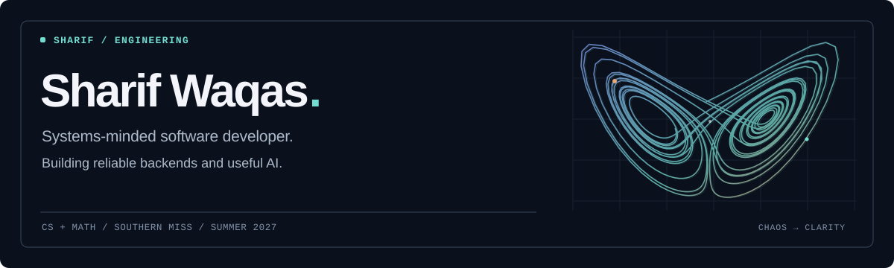

  <picture>
    <source media="(prefers-color-scheme: dark)" srcset="assets/hero-dark.svg">
    <source media="(prefers-color-scheme: light)" srcset="assets/hero-light.svg">
    
  </picture>

  <a href="https://sharifwaqas.vercel.app"><b>Portfolio ↗</b></a>
  &nbsp;&nbsp;·&nbsp;&nbsp;
  <a href="https://www.usesafestep.com/">Live project ↗</a>
  &nbsp;&nbsp;·&nbsp;&nbsp;
  <a href="https://www.linkedin.com/in/muhammad-sharif-77494139b/">LinkedIn ↗</a>
  &nbsp;&nbsp;·&nbsp;&nbsp;
  <a href="mailto:shaarif.1031@gmail.com">Email ↗</a>

---

### A little about me

I'm a **Computer Science & Mathematics sophomore at the University of Southern Mississippi** who likes building things that are both technically interesting and genuinely useful.

I focus on **backend engineering, performance, distributed systems, and practical AI**. I enjoy thinking through tradeoffs, measuring what matters, and making complex systems easier to understand.

**Right now:** learning Go and distributed-systems fundamentals, contributing to open source, and looking for **Summer 2027 software engineering internships**.

### Selected work

<table>
  <tr>
    <td width="39%" valign="middle">
      
    </td>
    <td valign="top">
      <h3>01 / <a href="https://github.com/SharifWaqas/safestep">SafeStep ↗</a></h3>
      
<b>Helping people make sense of suspicious digital content.</b>

      
An AI-assisted safety platform that interprets screenshots, explains warning signs, and turns risk assessments into actionable guidance. Built with a layered backend, session authentication, cloud object storage, and application-level risk scoring.

      
<code>Python</code> <code>FastAPI</code> <code>PostgreSQL</code> <code>Next.js</code> <code>AI</code>

      
<a href="https://www.usesafestep.com/">Try the app →</a> &nbsp;·&nbsp; <a href="https://github.com/SharifWaqas/safestep">Explore the code →</a>

    </td>
  </tr>
</table>

<table>
  <tr>
    <td width="39%" valign="middle">
      
    </td>
    <td valign="top">
      <h3>02 / <a href="https://github.com/SharifWaqas/log-analytics-backend">Log Analytics Engine ↗</a></h3>
      
<b>Instrumenting the systems behind the product.</b>

      
A queue-based ingestion and analytics backend with background workers, batched PostgreSQL writes, retry handling, and latency observability. It also processes structured telemetry from SafeStep.

      
<b>921.43 logs/sec</b> peak in a local concurrent-sender benchmark, about <b>20×</b> the measured baseline (not a production throughput claim).

      
<code>Python</code> <code>FastAPI</code> <code>Queues</code> <code>PostgreSQL</code> <code>Docker</code>

      
<a href="https://github.com/SharifWaqas/log-analytics-backend">Architecture & benchmarks →</a>

    </td>
  </tr>
</table>

### Open source

**[pytest · PR #15157](https://github.com/pytest-dev/pytest/pull/15157)** — Proposed a fix for string-based `monkeypatch.setattr` / `delattr` resolution when a cached submodule is missing its parent-package attribute. Added regression coverage for both operations and undo behavior.

### Tools I reach for

| | |
| :-- | :-- |
| **Languages** | Python · C++ · SQL · Go *(learning)* |
| **Backend & data** | FastAPI · REST APIs · PostgreSQL · SQLAlchemy |
| **Infrastructure** | Docker · Git · GitHub · queue-based processing |
| **AI** | Multimodal models · API integration · evaluation and risk logic |
| **Exploring next** | Distributed job queues · reliability · systems design |

---

  <b>Curiosity → experiments → useful software.</b>
   
  Open to collaborating on thoughtful backend, infrastructure, and applied-AI projects.

